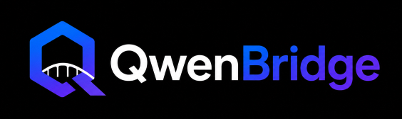
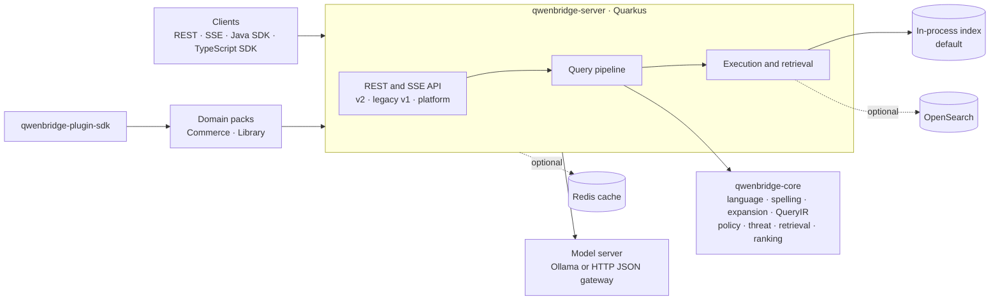

<p align="center">
  
</p>

<h1 align="center">QwenBridge</h1>

<p align="center">
  <strong>Multilingual query-understanding and search engine, built on Quarkus and Java 25.</strong>
</p>

<p align="center">
  <a href="#quick-start">Quick start</a> ·
  <a href="#architecture">Architecture</a> ·
  <a href="#sdks">SDKs</a> ·
  <a href="#documentation">Documentation</a> ·
  <a href="#contributing">Contributing</a>
</p>

<p align="center">
  
  
  
  <a href="LICENSE"></a>
</p>

---

QwenBridge turns a free-text query, in any supported language, into a typed, validated search
plan and runs it. It detects the language, corrects typos, optionally expands the query into
other languages, extracts grounded constraints into a versioned **QueryIR**, checks threats and
policy, and retrieves with keyword, vector or hybrid search. Every result is checked against the
query's hard constraints.

**No database, search engine or cache is required.** By default the server retrieves from an
in-process index and keeps its state in memory or on a local volume. OpenSearch and Redis are
optional and off by default.

| | |
|---|---|
| **Version** | 0.9.1 (QwenBridge 1.0 release candidate) |
| **Runtime** | Quarkus on Java 25. Quarkus is the only application framework ([certification](docs/architecture/quarkus-only.md)) |
| **Clients** | REST and SSE; Java SDK (Java 25); TypeScript SDK (Node.js 20+ and browsers) |
| **Model** | Any Ollama-compatible local model (default `qwen2.5`, embeddings `bge-m3`), or an HTTP JSON gateway |
| **License** | Apache 2.0 |

## What it does

| Area | Capabilities |
|---|---|
| **Language** | Script and model-based language detection, mixed-script segments, text direction, Unicode normalization |
| **Typo correction** | Dictionary-based, per language and per tenant; protects URLs, e-mail addresses, amounts and identifiers; modes `DISABLED`, `SUGGEST_ONLY`, `SAFE_AUTO_CORRECT` and `AGGRESSIVE` ([details](docs/architecture/typo-correction.md)) |
| **Multilingual expansion** | Optional translation of the query into configured target languages (glossary and model providers), fused retrieval across languages ([details](docs/architecture/multilingual-expansion.md)) |
| **Understanding** | Intent, grounded constraint extraction (every value quotes the query), QueryIR 1.1, schema registry, confidence and evidence |
| **Safety** | Request validation, 12 threat-detector families (SQL, NoSQL, LDAP, command, template, path traversal, SSRF, XSS, prompt injection, jailbreak, secret leakage, Unicode obfuscation), central policy and approvals, rate limits and quotas, tenant isolation |
| **Retrieval** | Keyword, vector and hybrid (rank fusion), adaptive planning, ranking policy, reranking, zero-result recovery, suggestions |
| **Platform** | Domain packs (Commerce, Library), connector-pack SPI, plugin SDK, signed packs and offline licences, editions |
| **Operations** | SmallRye Health, Micrometer metrics with latency histograms, OpenTelemetry tracing, structured logs |

## Quick start

**Requirements:** JDK 25, Maven 3.9+, and a local model server (Ollama). Docker is optional.

### 1. Start the model server

```bash
docker compose up -d qwenbridge-ollama qwenbridge-ollama-init   # pulls qwen2.5 and bge-m3
```

Plain `docker compose up -d` also starts Redis. QwenBridge uses it only as an optional cache and
for catalog synchronization.

### 2. Run the server

```bash
mvn -B install -DskipTests
mvn -pl qwenbridge-server quarkus:dev
```

The server listens on `http://localhost:8080`. Outside the `prod` profile it accepts anonymous
search requests (it logs a warning). The `prod` profile requires API keys
(`QWENBRIDGE_SECURITY_API_PRINCIPALS`); see [Configuration](docs/operations/configuration.md).

The packaged application (`java -jar qwenbridge-server/target/quarkus-app/quarkus-run.jar`) runs
the `prod` profile and refuses requests until API keys are configured. For a local trial, set
`QWENBRIDGE_SECURITY_AUTHENTICATION_REQUIRED=false`.

To run the packaged application in Docker instead:

```bash
docker compose --profile production up -d --build
```

### 3. Check health

```bash
curl -s http://localhost:8080/q/health/ready
```

### 4. Search over REST (v2)

```bash
curl -s http://localhost:8080/api/v2/search \
  -H 'Content-Type: application/json' \
  -d '{"query":"black running shoes under 100 EUR","contract":"commerce-search/1.0"}'
```

The response carries `status`, `intent`, the `queryIR` (with its grounded constraints), `results`,
`confidence`, `evidence`, `suggestions` and stage `timings`. With an API key, add
`-H "Authorization: Bearer $QWENBRIDGE_API_KEY"`.

### 5. Stream over SSE (v2)

```bash
curl -N http://localhost:8080/api/v2/search/stream \
  -H 'Content-Type: application/json' -H 'Accept: text/event-stream' \
  -d '{"query":"black running shoes under 100 EUR","contract":"commerce-search/1.0"}'
```

Each event has a monotonically increasing sequence number. The stream ends with exactly one
terminal event, `search.completed` or `search.failed`. See the [SSE contract](docs/api/sse.md).

### 6. Java SDK

```xml
<dependency>
  <groupId>io.qwenbridge</groupId>
  <artifactId>qwenbridge-java-sdk</artifactId>
  <version>0.9.1</version>
</dependency>
```

```java
import io.qwenbridge.sdk.commerce.CommerceClient;
import io.qwenbridge.sdk.commerce.CommerceContracts;
import java.net.URI;

try (var client = new CommerceClient(URI.create("http://localhost:8080"), apiKeyOrNull)) {
  client.requireCompatibleServer();
  var response = client.search(CommerceContracts.Request.planned("black running shoes under 100 EUR"));
  response.results().hits().forEach(hit -> System.out.println(hit.id() + " " + hit.score()));

  client.stream(
      CommerceContracts.Request.planned("winter jacket"),
      event -> System.out.println(event.kind()));
}
```

The SDK has no dependency other than Jackson. Install it locally with
`mvn -pl qwenbridge-java-sdk install`. See the [Java SDK README](qwenbridge-java-sdk/README.md).

### 7. TypeScript SDK

```bash
cd qwenbridge-typescript-sdk && npm ci && npm run build && npm pack   # @qwenbridge/sdk tarball
```

```ts
import { CommerceClient, COMMERCE_CONTRACT_V1 } from "@qwenbridge/sdk";

const client = new CommerceClient({ baseUrl: "http://localhost:8080", bearerToken: apiKey });
await client.requireCompatibleServer();

const response = await client.search({ query: "black running shoes under 100 EUR", contract: COMMERCE_CONTRACT_V1 });
for (const hit of response.results.hits) console.log(hit.id, hit.score);

const controller = new AbortController();
await client.stream({ query: "winter jacket", contract: COMMERCE_CONTRACT_V1 },
  event => console.log(event.kind), controller.signal);
```

The package has no runtime dependencies. See the [TypeScript SDK README](qwenbridge-typescript-sdk/README.md).

**Runnable consumers.** [`e2e/dual-sdk`](e2e/dual-sdk/README.md) contains two independent,
complete consumers, one per SDK. They cover v2 search, streaming, cancellation, typed errors and
the legacy v1 API, against a real server.

## Architecture



| Module | Responsibility | Depends on |
|---|---|---|
| `qwenbridge-core` | Framework-free engine: language, typo correction, expansion, QueryIR, extraction, validation, policy, threat detection, retrieval, ranking, recovery, connector SPI | Jackson only |
| `qwenbridge-plugin-sdk` | Public JDK-only contracts for plugins and packs | JDK only |
| `qwenbridge-commerce-pack` | Commerce domain pack: schema, rules, vocabulary | plugin SDK |
| `qwenbridge-library-pack` | Library domain pack, a second, independent domain | plugin SDK |
| `qwenbridge-server` | Quarkus runtime: REST and SSE APIs, pipeline, AI providers, execution, security, operations | core, plugin SDK, packs |
| `qwenbridge-java-sdk` | Java 25 client | Jackson only |
| `qwenbridge-typescript-sdk` | TypeScript client (npm `@qwenbridge/sdk`) | none at runtime |
| `e2e/dual-sdk` | End-to-end suite: both SDKs against the same real server | — |

Read more in the [architecture overview](docs/architecture/overview.md), the
[class diagrams](docs/architecture/class-diagrams.md), the [flows](docs/architecture/flows.md) and
the [sequence diagrams](docs/architecture/sequences.md).

## Optional dependencies

| Dependency | Default | Used for | When absent |
|---|---|---|---|
| Model server (Ollama) | Required for model-backed analysis | Analysis, embeddings, model translation | Deterministic analysis paths still run; model stages report degraded |
| OpenSearch | Off | Alternative retrieval backend (`QWENBRIDGE_SEARCH_BACKEND=opensearch`, `QWENBRIDGE_COMMERCE_BACKEND=opensearch`) | Not probed and not listed in readiness |
| Redis | Off for state | Analysis cache, distributed rate limits, catalog-sync checkpoint and lock | Caches and rate limits fall back to memory; `POST /api/v2/catalog/sync` returns a typed 503 |

## APIs

| API | Endpoints | Notes |
|---|---|---|
| v2 search | `POST /api/v2/search`, `POST /api/v2/search/stream`, refine, suggestions, feedback, recovery, sessions | Tenant-aware; [reference](docs/api/rest-api.md) |
| v2 language | `GET /api/v2/spelling`, `GET /api/v2/multilingual` | Effective typo and expansion configuration |
| v2 platform | `/api/v2/platform/*` (packs, connector packs, licences, editions, marketplace) | Administrative roles |
| v1 (legacy) | `POST /api/v1/search/analyze`, `GET /api/v1/search/stream/{requestId}` | Kept for backward compatibility; refused in authenticated deployments |
| Health | `/q/health/live`, `/q/health/ready`, `/api/v1/health` | SmallRye Health |
| Metrics | `/q/metrics` | Prometheus format |

## Build and verify

```bash
mvn -B clean verify                       # all modules and their tests
mvn -B -Pcode-quality -DskipTests verify  # Spotless, SpotBugs and architecture rules
bash scripts/verify-local.sh              # Java, TypeScript, packaging, versions, scripts
bash e2e/dual-sdk/scripts/run-dual-sdk-e2e.sh   # both SDKs end to end, offline
```

`bash scripts/qwenbridge-final-verification.sh` runs the complete master verification: build, all
suites, live runtime steps, performance, the Quarkus-only audit and the end-to-end suite. It
starts local Compose services and never deletes volumes. See [Testing](docs/development/testing.md).

## Documentation

The [documentation index](docs/README.md) lists everything. Start with:
- [Getting started](docs/development/getting-started.md)
- [Configuration](docs/operations/configuration.md)
- [Troubleshooting](docs/operations/troubleshooting.md)
- [REST API](docs/api/rest-api.md) and [SSE](docs/api/sse.md)
- [Architecture overview](docs/architecture/overview.md)
- [Remediation proposals](docs/architecture/remediation-proposals.md)
- [Release process](docs/publishing/release-process.md)

## Contributing

Read [CONTRIBUTING.md](CONTRIBUTING.md) and the
[branching and pull request policy](docs/development/branching-and-pr-policy.md). Changes need
tests, must pass `mvn clean verify` and the code-quality profile, and must keep the module
boundaries (the core stays framework-free; no database or search engine becomes mandatory).

## Security

Report vulnerabilities privately, as described in [SECURITY.md](SECURITY.md). Never commit
credentials, tokens or `.env` files. See [abuse protection](docs/security/abuse-protection.md) and
the [secrets policy](docs/security/secrets-handling-policy.md).

## License

QwenBridge is licensed under the [Apache License 2.0](LICENSE).
