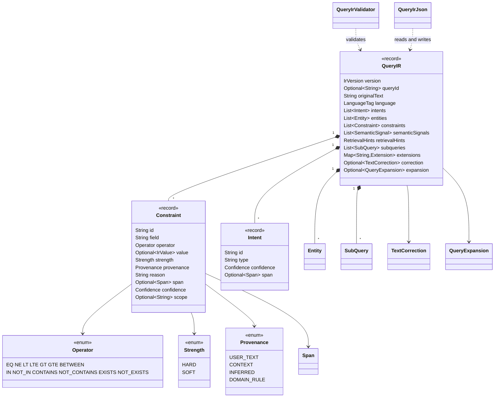
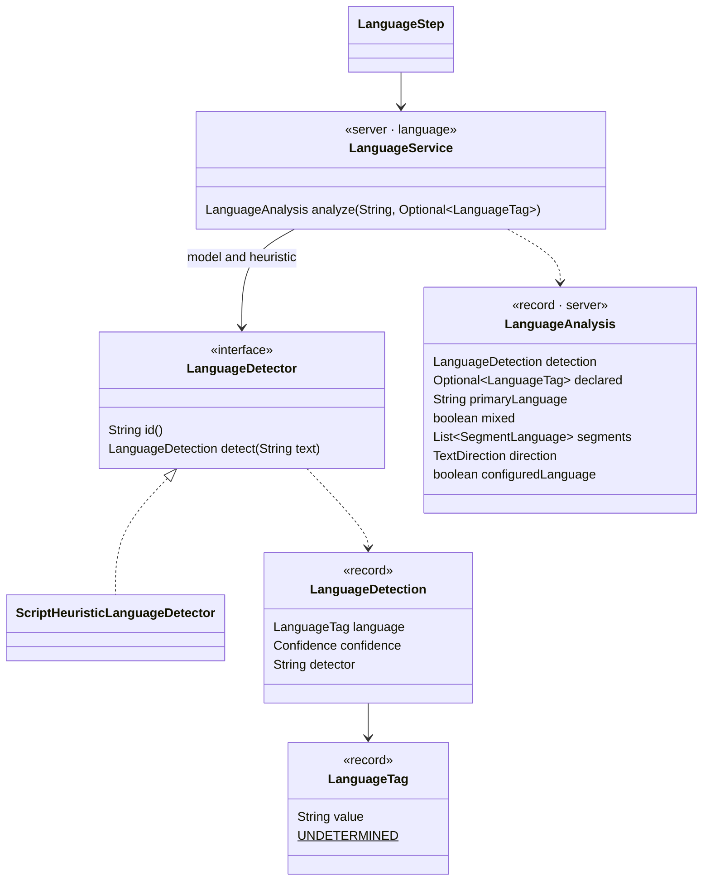
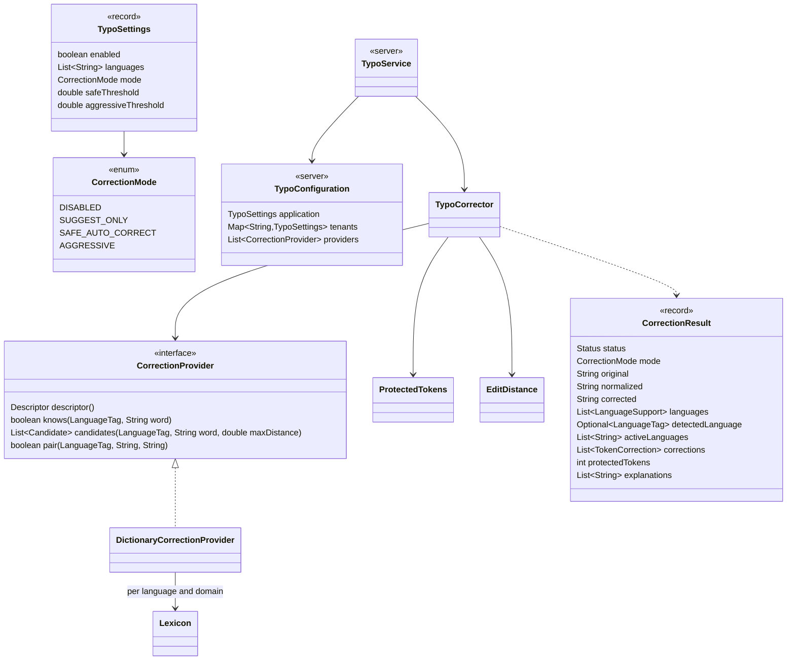
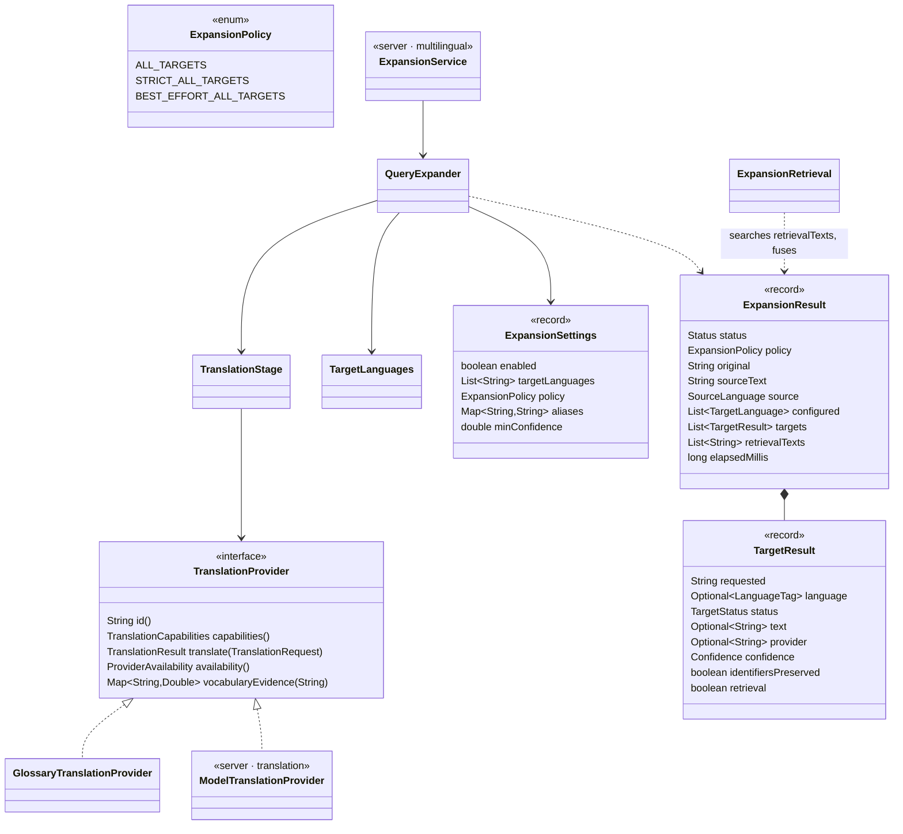
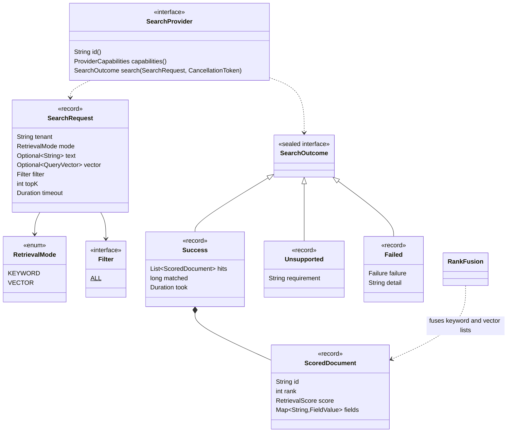
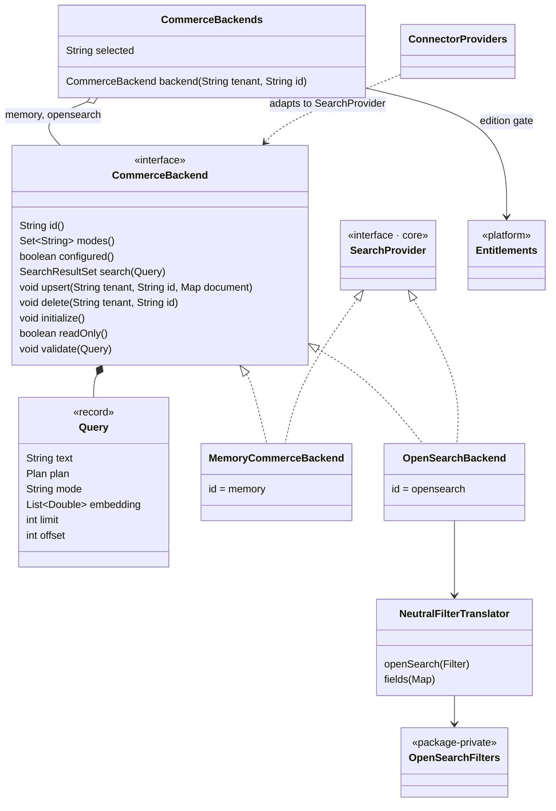
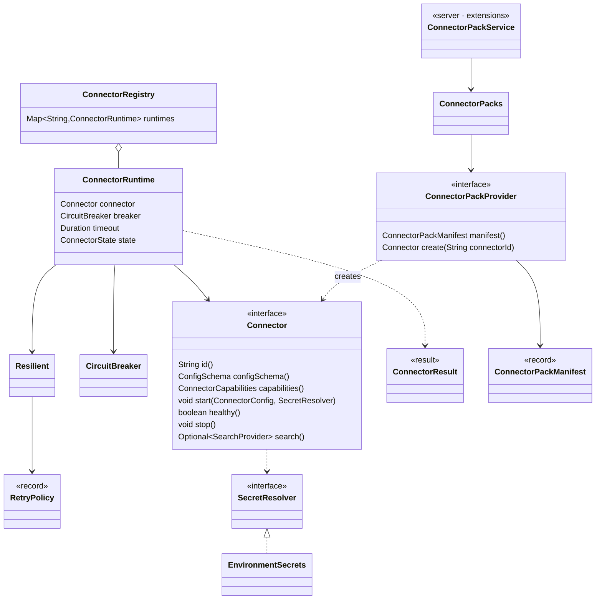
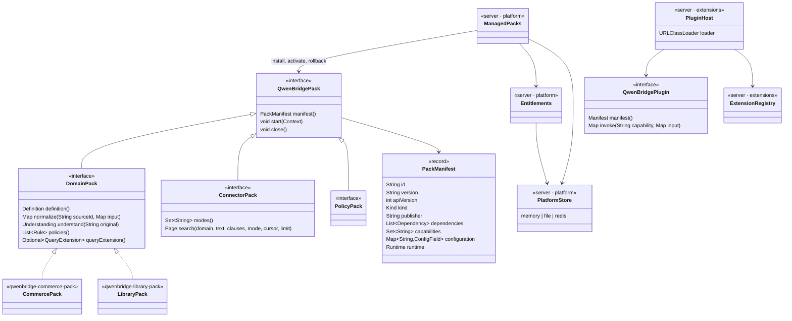
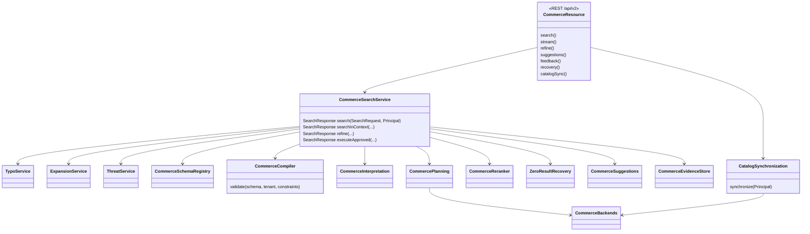
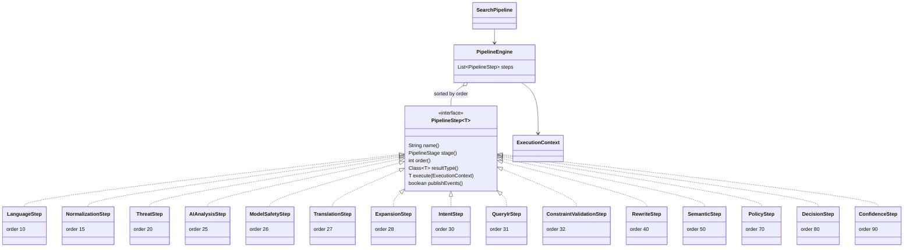

# Class Diagrams

These diagrams were generated from the source on 2026-11-02 (QB-287). They show the record
components, interface methods and enum constants as declared. Private helpers and most nested
types are left out. Package prefixes are shortened: `core.` stands for `io.qwenbridge.core.`, and
server packages are written without `io.qwenbridge.`.

## 1. QueryIR 1.1 (`core.queryir`)

`Span` points into `originalText`. A `HARD` constraint with provenance `USER_TEXT` must quote the
query. This rule is what "grounded" means.

## 2. Language detection

## 3. Typo correction (`core.spelling`, server `spelling`)

## 4. Multilingual expansion and translation

`TargetStatus` has the constants `SUCCESS`, `UNCHANGED`, `LOW_CONFIDENCE`,
`UNSUPPORTED_LANGUAGE`, `UNSUPPORTED_LANGUAGE_PAIR`, `PROVIDER_UNAVAILABLE`,
`SOURCE_UNDETERMINED`, `INVALID_LANGUAGE` and `FAILED`. A target without a translation carries no
text.

## 5. Retrieval SPI (`core.retrieval`)

`Failed.failure` is one of `TIMEOUT`, `CANCELLED`, `UNAVAILABLE` or `INVALID_REQUEST`. Hybrid
retrieval is two `SearchRequest`s, one per mode, fused by `RankFusion`.

## 6. Commerce backends (server `connectors`)

QB-287 removed the `elasticsearch`, `postgresql` and `mongodb` implementations. Those identifiers
now give "Unknown backend".

## 7. Connector SPI (`core.connector`)

`ConnectorResult.Failure` has the constants `NOT_READY`, `ACCESS_DENIED`, `CIRCUIT_OPEN`,
`TIMEOUT` and `CANCELLED`. In the test suite the SPI is exercised through
`extensions/testpack/ExampleConnectorPack` (test scope only).

## 8. Packs and plugins (`qwenbridge-plugin-sdk`, server `platform`, `extensions`)

## 9. v2 search service (server `commerce`)

`CommerceSearchService` still holds an `OpenSearchProvider` field, and `CatalogSynchronization`
holds an `OpenSearchApiClient` sink as a fallback. Both are listed in the
[remediation proposals](remediation-proposals.md#1-extract-opensearch-into-an-optional-connector-pack).

## 10. Legacy v1 pipeline (server `pipeline`)

The steps are CDI beans collected with `@All` and run in `order()` sequence. QB-287 removed the
orphaned per-step AI services: `DecisionService`, `IntentService`, `RewriteService`,
`SemanticService` and their `ai` implementations. No step injected them; the steps take their
results from `AIAnalysisStep`.
