# Flows

These 15 flowcharts show how the main operations proceed in the current source (QB-287,
2026-11-02). Each one names the class that implements it. The [sequence diagrams](sequences.md)
show the same paths as interactions between components.

## 1. v2 search, end to end

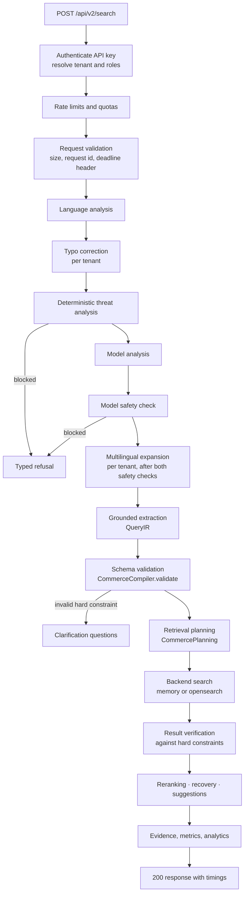

Implemented in `CommerceSearchService.search` and `run`. Each stage writes its duration into
`timings`. Under the planned contract (`commerce-search/1.0`), `CommerceInterpretation` replaces
the direct compile step and the planner chooses the strategy.

## 2. Language detection

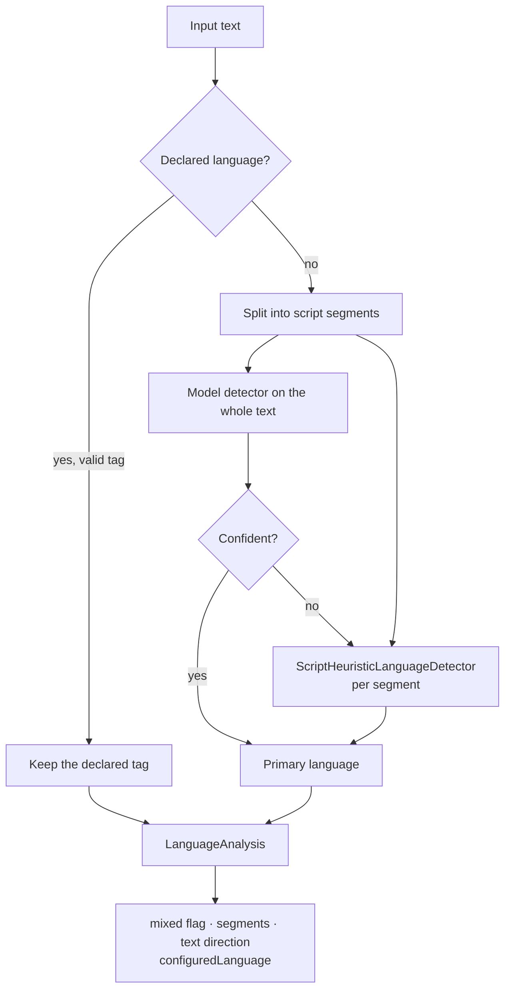

Implemented in `language.LanguageService`. Hindi in Devanagari, and Persian or Urdu by letter
sets, are separated by script rules.

## 3. Text normalization

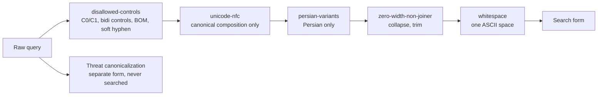

Implemented in `core.text.SearchTextNormalizer` (version `search-normalization-v1`). Each step is
deterministic, and the pipeline is idempotent. NFKC, case folding, URL or HTML decoding and digit
conversion are deliberately not applied, because they would change identifiers. The threat form
keeps the evidence the detectors need. The search form feeds typo correction and retrieval.

## 4. Typo correction

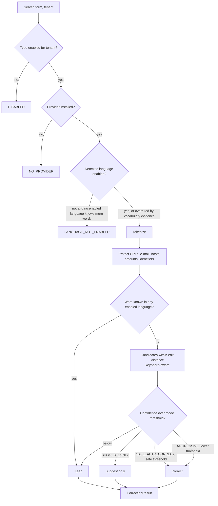

Implemented in `core.spelling.TypoCorrector`; tenant settings come from `spelling.TypoConfiguration`.

## 5. Multilingual expansion

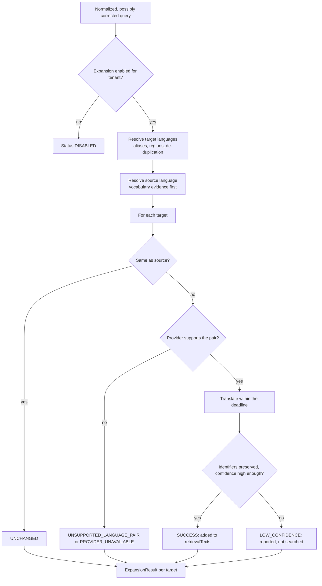

Implemented in `core.expansion.QueryExpander` and `multilingual.ExpansionService`, which applies a
semaphore and the overall deadline. A target without a translation never carries invented text.

## 6. Grounded extraction and QueryIR validation

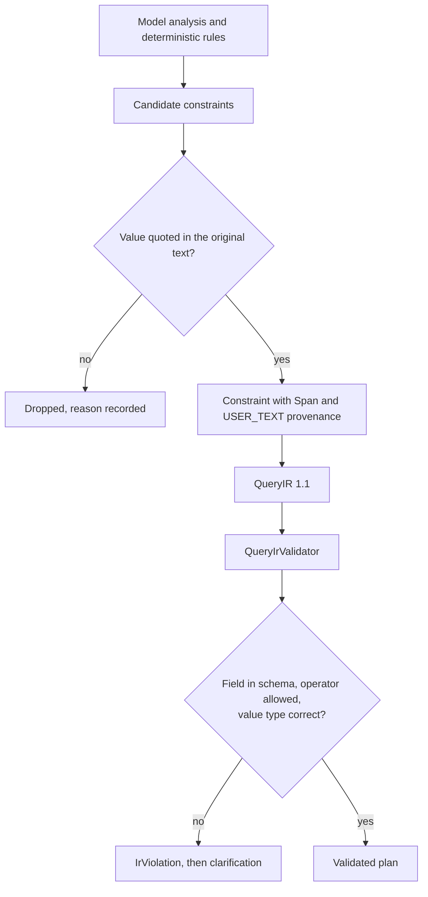

## 7. Threat and policy gate

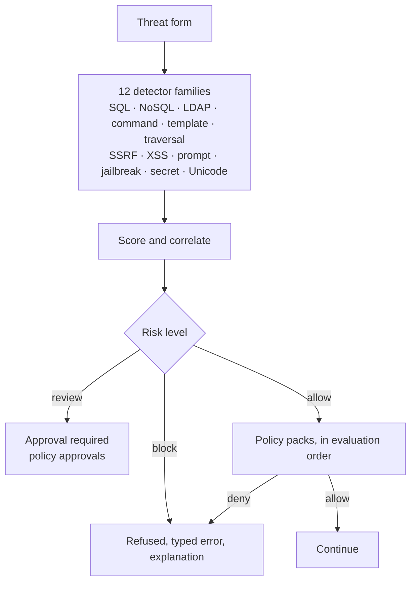

## 8. Retrieval planning

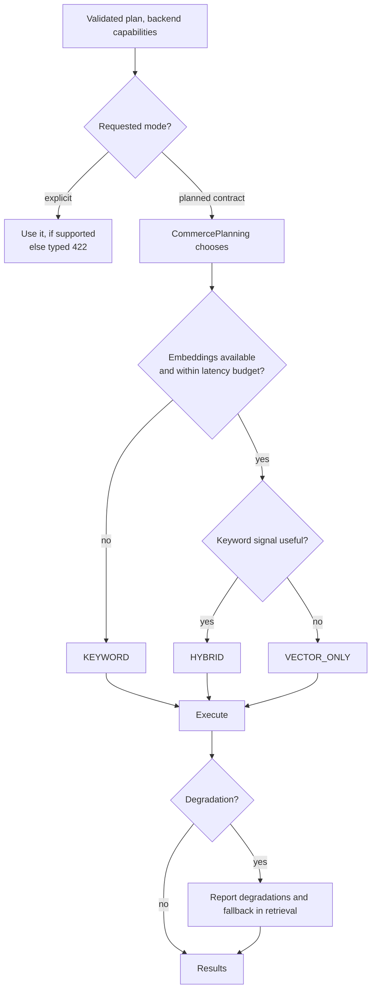

## 9. Hybrid fusion

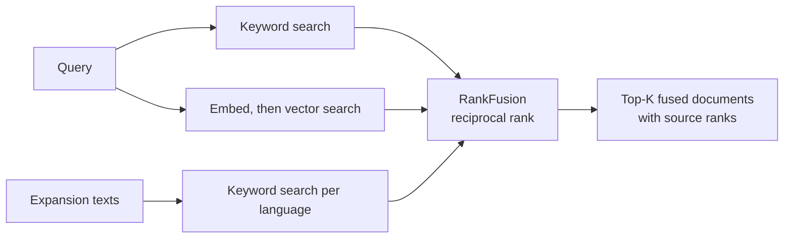

## 10. Result verification and zero-result recovery

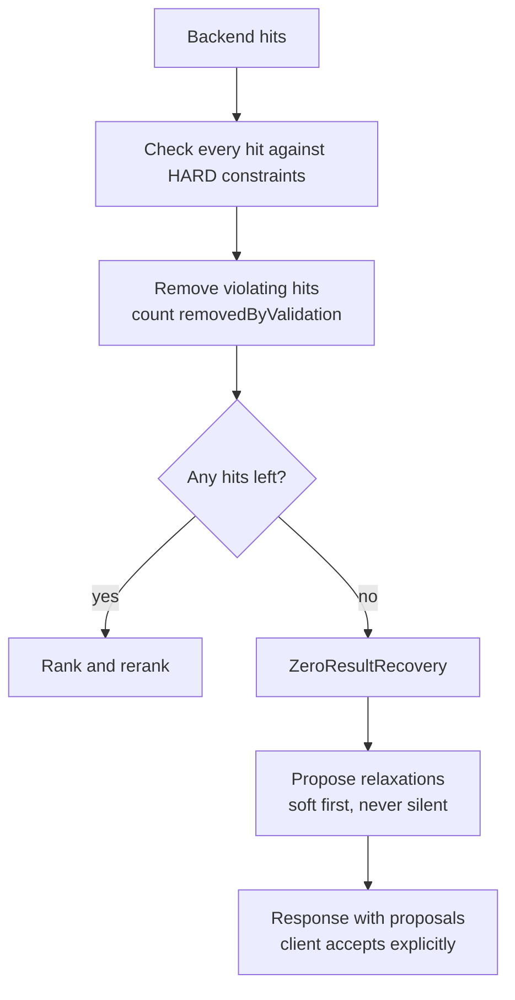

## 11. Backend selection

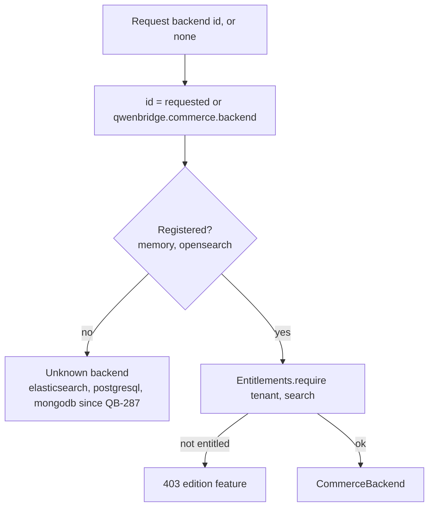

Implemented in `connectors.CommerceBackends.backend`.

## 12. Identity, authorization and rate limiting

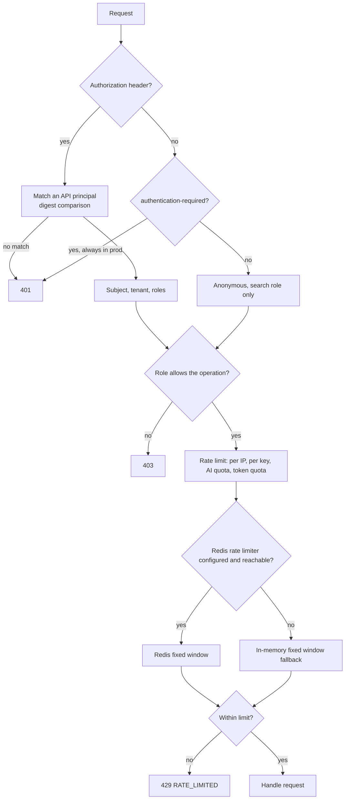

## 13. Catalog synchronization

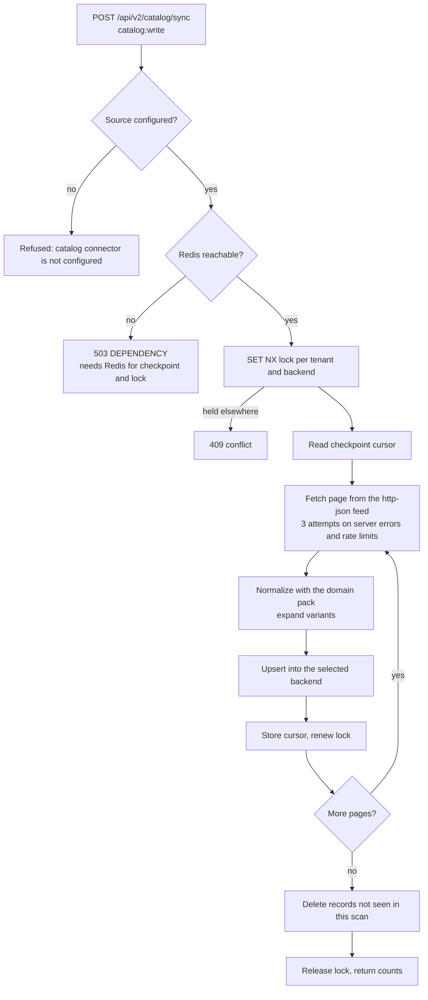

Implemented in `commerce.CatalogSynchronization.synchronize`. A Redis-free design is in
[remediation proposal 3](remediation-proposals.md#3-catalog-synchronization-without-redis).

## 14. Pack lifecycle

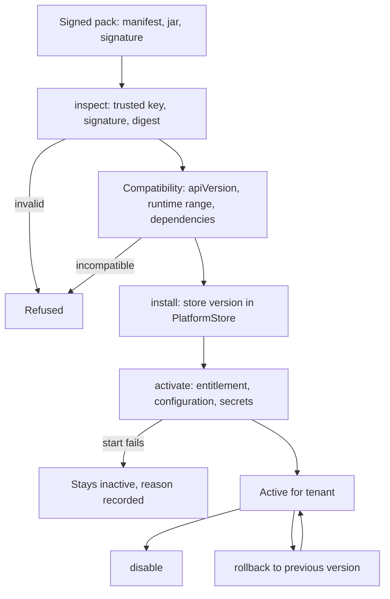

Implemented in `platform.ManagedPacks`.

## 15. Health and readiness

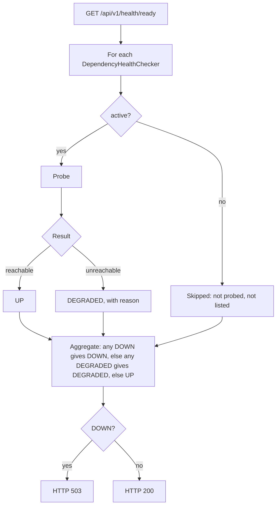

Implemented in `operations.health.OperationalHealthService` and `api.health.ApiHealthController`.
The checkers for Ollama, Redis and OpenSearch report an unreachable dependency as `DEGRADED`, so it
never fails readiness. `OpenSearchDependencyHealthChecker.active()` is true only when
`qwenbridge.search.backend` or `qwenbridge.commerce.backend` is `opensearch` (QB-287). Quarkus
`/q/health/live` and `/q/health/ready` (SmallRye Health) report the application itself.
