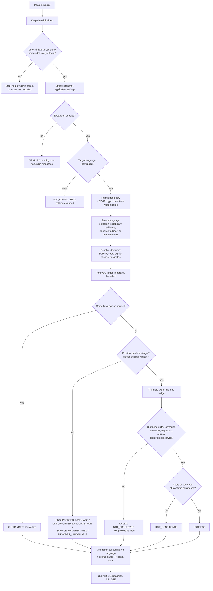

# Multilingual Query Expansion (QB-286)

QwenBridge can expand one query into a variant for **every target language the application owner
configures**: one query in, N results out, one per configured language. The engine is local,
stateless and provider-neutral, and needs no database, SaaS or external AI API. ADR 0055 records
the decisions.

**No target language is hardcoded or enabled by default.** With nothing configured, nothing is
expanded and nothing is assumed.

## Configuration

**Application level:**

```yaml
qwenbridge:
  multilingual:
    enabled: true                      # default false
    target-languages: [en, fa, sv, nb, nn]   # default: none; any BCP 47 identifiers
    policy: ALL_TARGETS                # ALL_TARGETS (default) | STRICT_ALL_TARGETS | BEST_EFFORT_ALL_TARGETS
    providers: [glossary, model]       # default: none; tried in this order
    glossary-dir: /opt/qwenbridge/glossary   # phrase tables for the glossary provider
    aliases: [SE=sv]                   # explicit compatibility aliases (this is the default)
    min-confidence: 0.5                # below this score or coverage: LOW_CONFIDENCE
    per-language-timeout: 5s
    timeout: 15s                       # whole expansion; also bounded by the request deadline
    max-parallel: 4                    # languages translated at once per request
    max-concurrent-translations: 16    # translations at once in the whole process
```

Environment variables follow the usual mapping, for example
`QWENBRIDGE_MULTILINGUAL_TARGET_LANGUAGES=en,fa,sv`.

**Tenant level.** `qwenbridge.multilingual.tenants` is a JSON object. A tenant's settings replace
the application's for that tenant only, and no storage is involved:

```json
{"shop-a": {"enabled": true, "targetLanguages": ["en", "fa", "sv"]},
 "shop-b": {"enabled": true, "targetLanguages": ["de", "fr", "es", "it"], "policy": "STRICT_ALL_TARGETS"}}
```

`GET /api/v2/multilingual` (permission `search`) shows the caller's effective settings:
- each configured identifier with its resolution;
- the providers that produce each language;
- the installed providers, with their declared pairs, availability and requirements;
- the limits.

### Language identifiers

| Input | Result |
|---|---|
| `en`, `zh-Hans`, `pt-BR` | `VALID` |
| `EN`, `FA`, `NB`, `NN`, `zh-hans` | `NORMALIZED` to `en`, `fa`, `nb`, `nn`, `zh-Hans` |
| `SE` | `ALIAS` to `sv`, only because `SE=sv` is a configured alias. Aliases match exactly: lower-case `se` stays Northern Sami |
| `NO`, `DE`, `SV` (upper case) | `AMBIGUOUS_REGION_CODE`: both a region and a language; not guessed. Write language codes in lower case |
| `DK`, `US` | `INVALID`: a region code, not a language |
| `english`, `e_n`, empty | `INVALID` |
| `und`, `mul`, `zxx` | `NOT_A_TARGET` |
| A repeat after normalization | `DUPLICATE`; it gets no second result |

Every identifier is reported. Invalid ones get an `INVALID_LANGUAGE` result, never silence. The
configured order is kept.

## Processing



### Source language

The source language is independent of the targets: a query can be in any detectable language. It
is established in this order:
1. **Mixed text:** a reliable detection of mixed text gives `mul`. A provider must accept mixed
   text, otherwise the result is `UNSUPPORTED_LANGUAGE_PAIR` with reason "mixed-language source".
2. **Script-based detection** (deterministic or heuristic, for example Persian or CJK) is used as
   is.
3. **Vocabulary evidence.** This applies when the detector decided statistically without a score
   (Lingua in low-accuracy mode), or decided nothing. The ready providers report how many of the
   query's words (three or more letters, not protected) they know per language. A language that
   covers at least half of the words, and more than the detected language does, becomes the source
   (`basis: VOCABULARY`), and the response explains why. This is the same rule QB-291 uses for
   typos.
4. **Declared language:** the client's declared language is used when detection was inconclusive.
5. **Otherwise undetermined.** Providers that cannot detect a language report
   `SOURCE_UNDETERMINED`. Nothing is guessed.

**Why vocabulary evidence exists.** On this repository's detector configuration, the following
English queries were measured:

| Query | Detected as |
|---|---|
| "I need a red winter jacket under 100 euros" | Swedish |
| "I need blak shoes under 100 euros" | Afrikaans |
| "show errors from redis03-pt1 in the last 30 minutes" | Undetermined |

Without the evidence rule, the first query would have produced a Swedish "UNCHANGED" result
containing English text.

### Per-language statuses

| Status | Meaning | Text |
|---|---|---|
| `SUCCESS` | Translated; every checked meaning and every protected identifier kept | Yes |
| `UNCHANGED` | Already in this language; the normalized source query | Yes |
| `LOW_CONFIDENCE` | Translated; score or coverage below `min-confidence` | Yes, flagged |
| `UNSUPPORTED_LANGUAGE` | No installed provider produces it | No |
| `UNSUPPORTED_LANGUAGE_PAIR` | A provider produces it, but not from this source (or mixed text) | No |
| `PROVIDER_UNAVAILABLE` | No provider, or the capable one is missing its model or resources | No |
| `SOURCE_UNDETERMINED` | The source is unknown and no capable provider detects it | No |
| `INVALID_LANGUAGE` | Invalid or ambiguous identifier | No |
| `FAILED` | `TIMEOUT`, `PROVIDER_ERROR`, `INVALID_OUTPUT`, `NOT_PRESERVED`, `CANCELLED` or `BUSY` | No |

No text is ever produced to fill a failed target.

### Policies and overall status

| Policy | Retrieval uses | Overall status |
|---|---|---|
| `ALL_TARGETS` (default) | `SUCCESS` and `UNCHANGED` variants | `COMPLETE`, `PARTIAL` or `FAILED` |
| `STRICT_ALL_TARGETS` | Nothing but the source, unless every target is `SUCCESS` or `UNCHANGED` | `FAILED` when any target is not; each target is still reported |
| `BEST_EFFORT_ALL_TARGETS` | Also `LOW_CONFIDENCE` variants, flagged | As `ALL_TARGETS` |

Other overall statuses are `DISABLED`, `NOT_CONFIGURED` and `CANCELLED`. No policy reduces the
configured list.

**Retrieval texts:** the source text first, then each distinct usable variant. Duplicates are
detected without regard to Unicode normalization (NFC), case or whitespace. A variant equal to the
source or to an earlier variant is not used twice.

### Semantic and technical preservation

Every translation passes the existing preservation check (`PreservationChecker`, ADR 0019).
Numbers, units, currencies, operators, negations, entities and identifiers must survive. A changed
translation is rejected as `NOT_PRESERVED`, and the next provider is tried.

**Verbatim tokens:** the engine also requires every protected token to appear verbatim in the
translation:
- URLs, e-mail addresses, IP addresses and UUIDs;
- host names and codes;
- joined technical identifiers such as `redis03-pt1`;
- the contents of quoted values.

Currencies are never converted and thresholds never changed.

**Verification coverage:**
- **Fully verified** for languages whose cue words the Core knows (en, sv, fa):
  operators, negations and currencies.
- **Other languages:** these kinds are reported as unverified (`PARTIALLY_VERIFIED`), never as
  preserved.

### Bounds, cancellation and cleanup

- **Parallelism:** languages run in parallel up to `max-parallel` per request. Every translation
  also takes a permit from one process-wide semaphore (`max-concurrent-translations`).
- **Timeouts:** each language has `per-language-timeout`. The expansion has `timeout`, also
  bounded by the request's own deadline.
- **Cancellation and deadlines:** when the request is cancelled or out of time, waiting stops,
  workers are interrupted, permits are released, and unfinished languages are reported (`CANCELLED`
  or `TIMEOUT`), never dropped.

## Providers

Providers implement the Core SPI `TranslationProvider`. QB-286 extends it with defaults, so
existing providers keep working:
- **declared pairs:** `TranslationCapabilities.pairs`, as `source>target`; empty means every
  combination;
- **`availability()`:** `READY`, `INITIALIZING`, `MODEL_UNAVAILABLE`, `MISSING_RESOURCES` or
  `FAILED`;
- **`requirements()`, `metadata()`;**
- **`vocabularyEvidence(text)`.**

A provider is used only when it is ready and declares the pair. Several providers are tried in the
configured order.

| Id | Provider | Notes |
|---|---|---|
| `glossary` | `GlossaryTranslationProvider` (Core) | Offline phrase tables `<source>_to_<target>.tsv`, each line `source phrase<TAB>target phrase`. Greedy longest-phrase match (up to 6 words). Protected tokens, numbers and punctuation are copied unchanged. Reports coverage and vocabulary evidence. Phrase substitution, not machine translation: word order changes only through phrase entries. The Core ships no tables |
| `model` | `ModelTranslationProvider` (server) | The configured local chat model (Ollama by default). Confidence `MODEL_DECISION`, with no number |
| Any other id | Discovered with `ServiceLoader` | — |

**Unavailable providers:** a configured provider that cannot start is kept as unavailable (for
example a missing glossary directory, or not installed). Its languages report
`PROVIDER_UNAVAILABLE` with the reason. Startup does not fail.

## QueryIR, API, SSE and SDKs

- **QueryIR 1.1:** optional `expansion` object (`status`, `policy`, `sourceText`, `sourceLanguage`,
  `configuredTargets`, `targets[]`). It is written only when expansion is enabled; 1.0 documents are
  unchanged. `originalText` is never replaced, and constraints stay grounded in it.
  - **v1 analyze:** carries the QueryIR expansion.
  - **v2:** its response `queryIR` is the Commerce plan, which carries no expansion. The expansion is
    in the response's `expansion` field.
- **Responses:** v1 `POST /api/v1/search/analyze`, v2 `POST /api/v2/search` and the v2 SSE terminal
  event (`search.completed`) carry `expansion` when it is enabled for the caller. The field
  includes:
  - `original`, `originalRef`, `sourceText`, `source`;
  - `configured`, `requestedLanguages`, `successfulLanguages`, `unsupportedLanguages`;
  - `targets[]`, `retrievalTexts`, `explanations`.

  Preservation issues show only kinds, directions and counts. The field is absent when expansion is
  disabled, or when the query was stopped by a safety check before expansion. SSE has no
  per-language events: results arrive in the terminal event.
- **SDKs:**
  - **Java:** `io.qwenbridge.sdk.expansion.Expansion`, on `SearchAnalyzeResponse.expansion()` and
    `CommerceContracts.Response.expansion()`.
  - **TypeScript:** `Expansion`, on `SearchAnalyzeResponse.expansion` and
    `CommerceResponse.expansion`.
  - **Golden fixture:** `contract/v2-search-expansion.json`, captured from the server, is shared by
    both SDKs' tests. The server test fails if the server returns a field the fixture lacks.
- **Core retrieval helper:** `ExpansionRetrieval.keyword` searches the source text and each variant
  with the same tenant and hard filter, and fuses the lists with reciprocal rank fusion. A document
  is counted once, and hard constraints are applied identically.
- **Typo correction (QB-291):** it runs first and only when it is itself enabled. Expansion never
  enables it, and there is no loop between the two.

## Measurements

| Measurement | Result | Source |
|---|---|---|
| Orchestration overhead, 10 targets, deterministic fake provider, 500 runs | p50 1.05 ms, p95 1.59 ms, p99 3.25 ms | `ExpansionPerformanceTest` (`target/benchmarks/expansion-performance.json`) |
| Glossary provider, 4 targets, test tables, 500 runs | p50 0.48 ms, p95 0.76 ms | Same |
| Memory retained per 10-target result | About 4.4 KB | Same |
| Live first request: whole expansion | 1,341 ms | Master step 22 (QB-286), packaged app, local Ollama `qwen2.5` |
| Live first request: glossary languages | 34–37 ms each | Same |
| Live first request: model translation, de | 643 ms | Same |
| Live first request: model translation, ja | 1,336 ms | Same |

**Live translations** returned by the local model: "Ich benötige eine rote Winterjacke unter
100 Euro" (de) and "私は100ユーロ未満の赤い冬用ジャケットが必要です" (ja). Both were reported
`PARTIALLY_VERIFIED`, because operators and currency words are not checked in de or ja.

**Cost and quality caveats:**
- **Cost:** it grows with the number of model-served languages. The local model has a single slot,
  so model translations queue (FU: model bottleneck).
- **Test tables:** they are hand-written fixtures. The figures show the engine and provider
  mechanics, not translation quality.

## Limitations

- **Source detection:** the system language detector misjudges some short Latin-script queries.
  Vocabulary evidence corrects this only where an installed provider has a vocabulary (glossary).
  With only the model provider, a misdetected source stands.
- **Retrieval integration:**
  - The variants and the Core helper are available, but v2 Commerce search does not yet search with
    the variants. It still uses its own single retrieval text (model rewrite and translation). The
    variants are reported for consumers.
  - v1 is analysis-only, as before.
- **v1 settings:** v1 has no tenant, so it uses the application settings.
- **Mixed-language text:** it is translated as a whole, only by providers that accept mixed input.
  It is not split by segment.
- **Glossary provider:** phrase substitution; it does not reorder words beyond its phrase entries.
- **Model provider:** quality is not scored (`MODEL_DECISION`), only preservation-checked.
- **Early stops:** when a query is held for review or blocked, it is not expanded and no expansion
  is reported.
