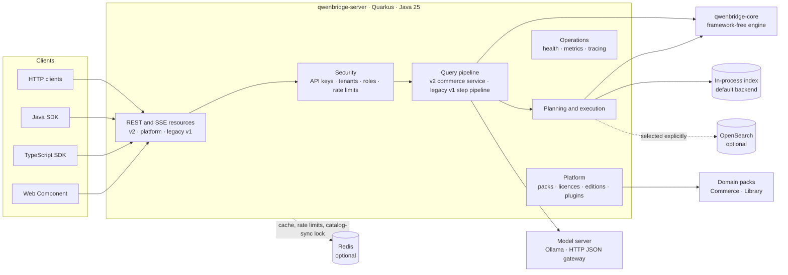
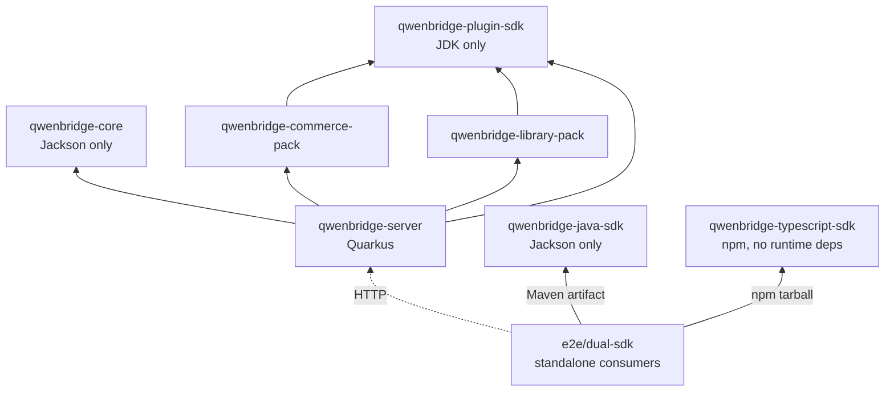
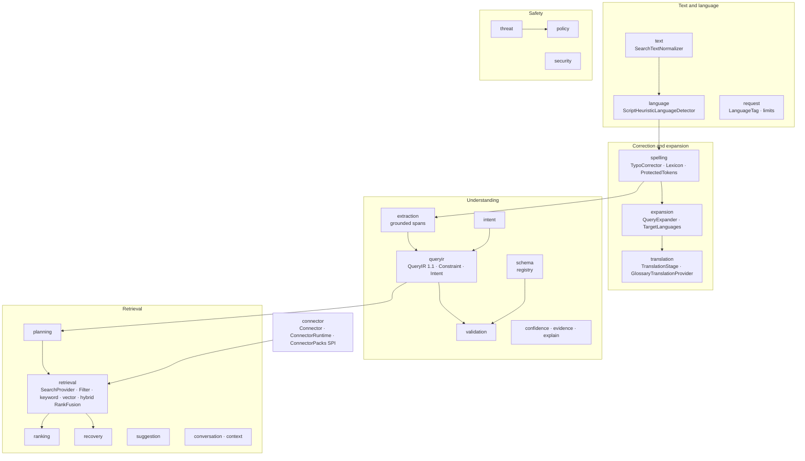
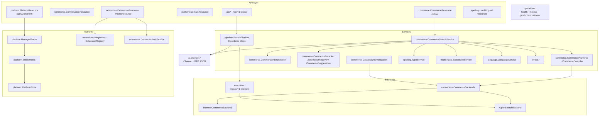
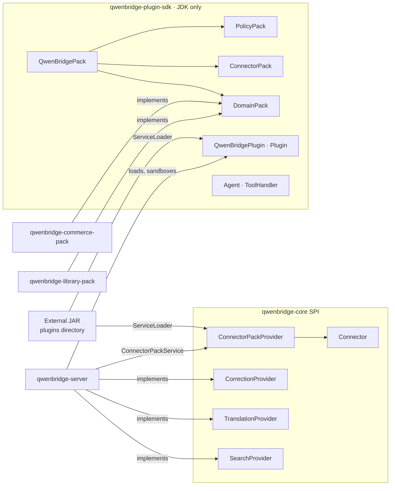
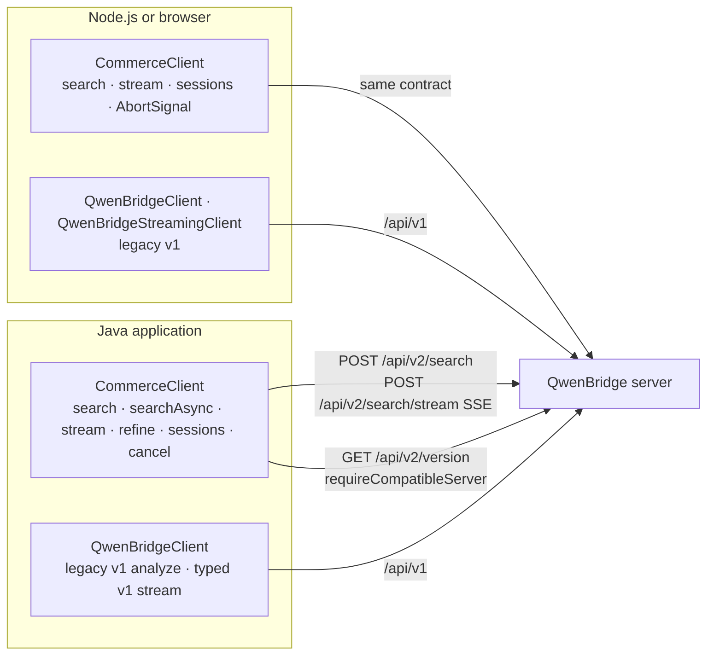
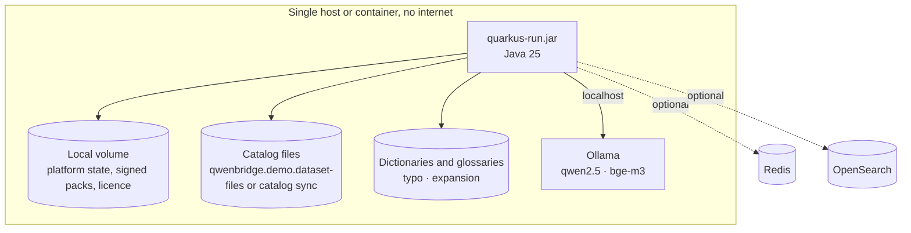
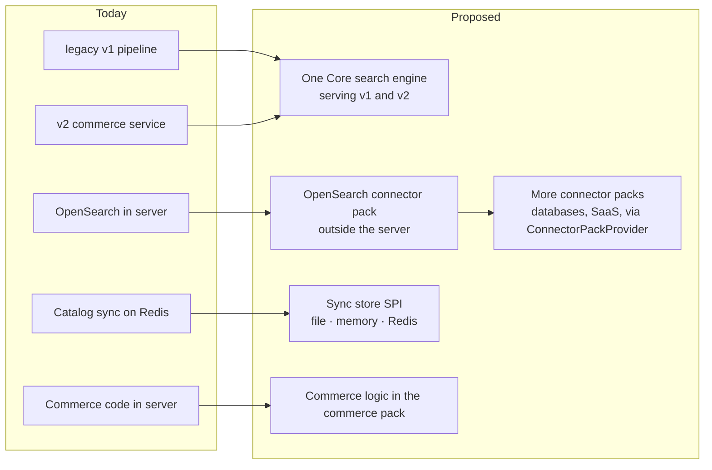

# Architecture Overview

QwenBridge is a multilingual query-understanding and search engine. A framework-free **Core**
holds the language, spelling, expansion, QueryIR, safety and retrieval logic. A **Quarkus server**
exposes it over REST and SSE, and two **SDKs** consume that API. Domain knowledge lives in
**packs**. No database, search engine or cache is mandatory.

This page has the eight structural diagrams. The [class diagrams](class-diagrams.md),
[flows](flows.md) and [sequence diagrams](sequences.md) go into detail.
[Remediation proposals](remediation-proposals.md) describes the couplings that remain and how to
remove them.

**State after QB-287 (2026-11-02):**
- **Reactor:** seven Maven modules plus the TypeScript SDK.
- **Removed:** the Elasticsearch, PostgreSQL, MongoDB and Shopify connector modules, and
  `examples/`.
- **Backends:** the in-process backend (default) and OpenSearch (optional).

## 1. Overall system

| Concern | Where | Default |
|---|---|---|
| Retrieval | `connectors.MemoryCommerceBackend` (core `InMemoryKeywordIndex`, vector index) | In process |
| Optional retrieval | `connectors.OpenSearchBackend`, `execution.provider.opensearch` | Off |
| Platform state (packs, licences, sessions) | `platform.PlatformStore` | Memory, or a file directory |
| Cache and distributed rate limits | `analysis.cache`, `abuse.RedisBackedRateLimiter` | In-memory fallback |
| Model | `ai.provider.*` | Ollama on `localhost:11434` |

## 2. Maven module graph

`jsdk` and `tssdk` depend on no other module; they talk to the server only over HTTP. Tests
enforce these rules:
- `ArchitectureNeutralityTest`: the core's only runtime dependency is Jackson; no framework,
  driver, SQL or network-client imports in the core; no Shopify code anywhere.
- `DriverDependencyTest`, `QuarkusOnlyArchitectureTest`, `ShopifyIsolationTest`.
- `scripts/verification/quarkus_only_audit.py`.

## 3. Core components

The core has 234 classes in 28 packages and depends only on `jackson-databind`. Every external
effect (model calls, translation, search engines) enters through an interface the server
implements: `SearchProvider`, `TranslationProvider`, `CorrectionProvider`, `Connector`.

## 4. Server components

The server has 406 classes. The two largest areas are the legacy v1 path (`pipeline` 40,
`execution` 36, `threat` 45, `analysis` 19) and the v2 commerce path (`commerce` 23,
`connectors` 8). [Remediation proposals](remediation-proposals.md) covers both.

## 5. Plugin, pack and adapter SPI

- **Domain packs:** add schemas, vocabulary and rules. Commerce and Library ship in the reactor.
- **Connector packs:** add data sources through `ConnectorPackProvider`, discovered by
  `ServiceLoader`. Each connector runs inside `ConnectorRuntime`, which provides a circuit
  breaker, retries, timeouts and a typed state.
- **Plugins:** external JARs in a plugins directory, loaded by `PluginHost` in their own class
  loader. They register tools and agents in `ExtensionRegistry`.
- **Gating:** edition features gate packs (`Entitlements`). Distribution is signed
  (`SignedDocuments`).

## 6. SDK integration

Both SDKs implement the same behaviour:
- **Retries:** only search, refine and reads are retried, always with the same request ID.
- **Deadlines:** the per-call timeout is sent as `X-Request-Timeout-Ms`.
- **Cancellation:** aborts the HTTP call and asks the server to cancel (`DELETE` of the request).
- **Errors:** typed, carrying `status`, `code`, `category` and `retryable`.

The [dual-SDK E2E suite](../../e2e/dual-sdk/README.md) checks that the two SDKs give equivalent
contract views.

## 7. Offline deployment

**Without Redis and OpenSearch:**
- the server starts and reports ready;
- retrieval runs in process;
- licences are verified offline against trusted keys.

**What needs the optional services:**
- **Catalog synchronization from an HTTP feed** needs Redis for its checkpoint and lock. Without
  it, the endpoint returns a typed 503.
- **Model-backed stages** need the local model server.

Docker Compose matches this layout. The default profile starts Ollama and Redis.
`--profile production` adds the application; `--profile opensearch` adds OpenSearch.

## 8. Future extension

Each arrow is a proposal in [remediation-proposals.md](remediation-proposals.md), with affected
modules, behaviour changes, migration steps and acceptance criteria. None of them is implemented.
New data sources should arrive as connector packs. They should not arrive as server modules,
which QB-287 removed.

## Boundaries

| Package | Responsibility |
|---|---|
| `commerce`, `connectors` | v2 search service, planning, backends |
| `api`, `pipeline`, `execution`, `analysis`, `decision`, `intent`, `semantic` | Legacy v1 analyze pipeline |
| `language`, `spelling`, `multilingual`, `translation`, `normalization` | Server adapters for the Core's language features |
| `threat`, `abuse`, `security` | Input safety, rate limits, identity and roles |
| `platform`, `extensions`, `plugins`, `domains` | Packs, licences, editions, plugins, agents |
| `streaming`, `event` | SSE delivery and pipeline events |
| `operations` | Health, metrics, production configuration validation |

The ADRs in [`docs/adr/`](../adr/) record the decisions behind these boundaries. ADR 0058 records
QB-287.
