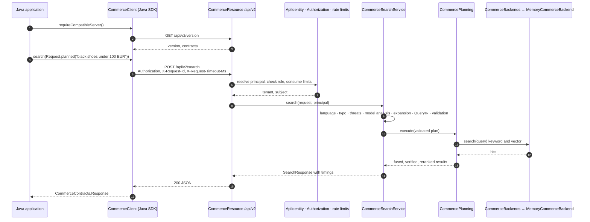
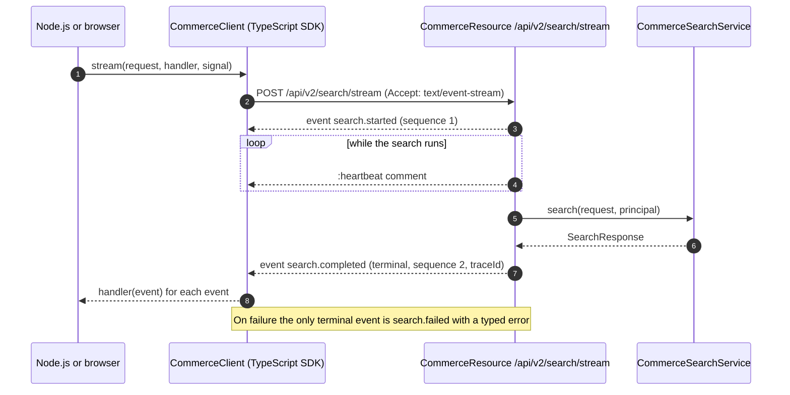
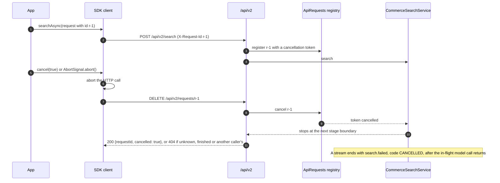
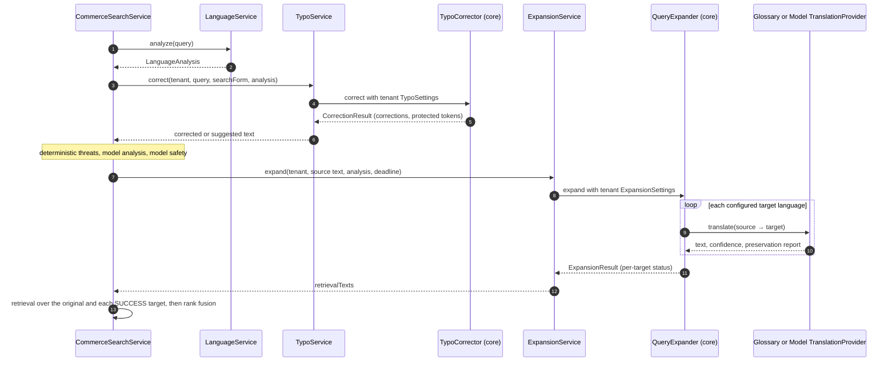
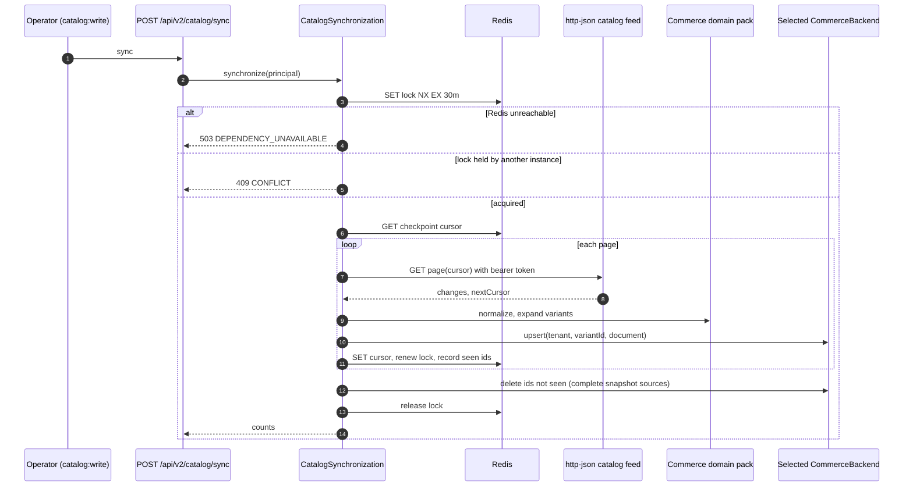
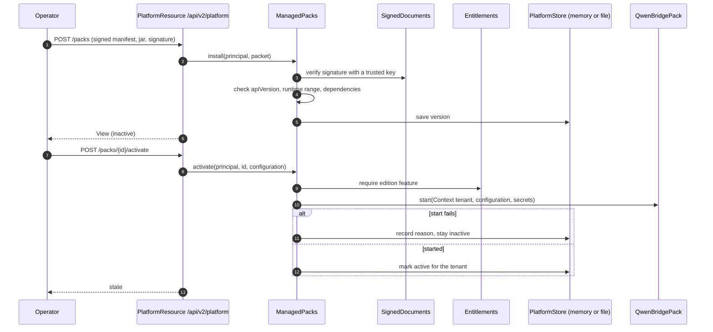
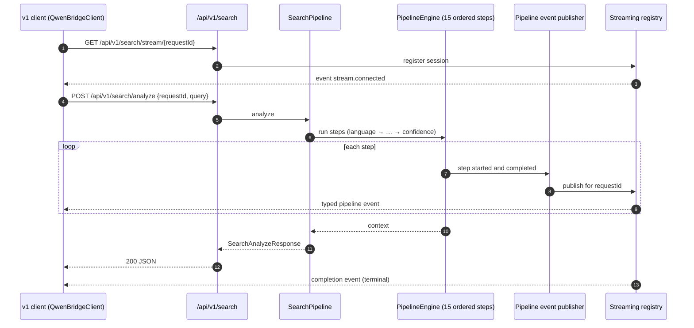

# Sequence Diagrams

These seven interactions are taken from the current source (QB-287, 2026-11-02). The
[dual-SDK E2E suite](../../e2e/dual-sdk/README.md) exercises all of them against a real server.

## 1. v2 search with the Java SDK

On a retryable failure the SDK repeats the call with the same request ID. A failure is retryable
when it is a transport error, or when the v2 error says `retryable` (v1: 429, 502, 503 or 504). It never retries session turns, acceptances or streams.

## 2. v2 SSE stream with the TypeScript SDK

Exactly one terminal event is sent, and sequence numbers increase strictly.

## 3. Cancellation

## 4. Typo correction and multilingual expansion inside a search

## 5. Catalog synchronization

## 6. Pack installation and activation

## 7. Legacy v1 analyze and stream

The legacy v1 API is refused (409) in deployments that require authentication, because it is not
tenant-aware. [Remediation proposal 2](remediation-proposals.md#2-serve-the-v1-api-from-the-core-engine)
describes how to serve it from the Core engine.
