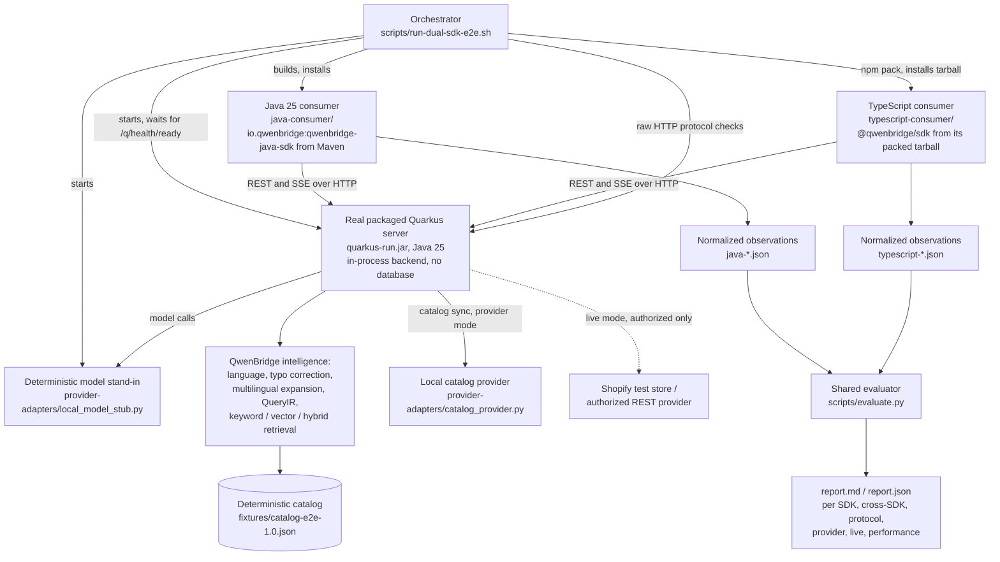

# Dual-SDK End-to-End Suite (QB-295, QB-287)

The suite runs the **Java SDK** and the **TypeScript SDK** as two independent consumers against
the **same real Quarkus server**, over real HTTP and SSE. Both execute the **same shared
scenarios**, and **one evaluator** judges both SDKs against the same expectations and compares
them. Nothing is mocked inside the SDKs or the server. Only the server's environment is
controlled:
- a deterministic catalog;
- a deterministic local model stand-in;
- local test providers.

ADR 0057 records the design.



## Layout

| Path | Content |
|---|---|
| `scenarios/scenarios.json` | The shared, provider-neutral scenario contract (45 scenarios, including 3 for the legacy v1 API, added in QB-287) |
| `fixtures/catalog-e2e-1.0.json` | 24 invented, generic products: ids, titles, descriptions, categories, prices and currencies, variants, availability, attributes, weights. Includes deliberate traps |
| `fixtures/model-answers.json` | Reviewed answers of the model stand-in. Every filter quotes its own query |
| `fixtures/typo/`, `fixtures/glossary/` | Test dictionaries and phrase tables (en, sv, fa; en→sv/fa/nb/nn, sv→en) |
| `java-consumer/` | Standalone Maven project, not a reactor module. Depends on the SDK artifact `io.qwenbridge:qwenbridge-java-sdk:0.9.1` |
| `typescript-consumer/` | Standalone package. Imports `@qwenbridge/sdk` by name only, installed from the SDK's `npm pack` tarball. Type-checked with `tsc` |
| `provider-adapters/` | `local_model_stub.py` (Ollama-compatible `/api/chat`, `/api/embed`, `/api/tags`); `catalog_provider.py` (an `http-json` change feed with switchable failure modes); `shopify_check.py` (read-only Admin GraphQL contract check, mock or live) |
| `scripts/` | `run-dual-sdk-e2e.sh` (orchestrator), `evaluate.py`, `protocol_checks.py`, `provider_checks.py`, `live-providers.sh`, `redis_ping.py` |
| `reports/` | One directory per run; not versioned |

**Catalog traps** in `fixtures/catalog-e2e-1.0.json`:
- a SEK price;
- out-of-stock items;
- a refurbished item;
- Swedish and Persian titles;
- a technical identifier (`FX-2040`);
- a two-variant product.

## Modes

| Mode | Server | What it adds | Requirement |
|---|---|---|---|
| `OFFLINE_BASELINE` (mandatory) | Real jar on `QB295_PORT` (default 18295), authentication on; a second jar on port +4 without authentication for the legacy v1 scenarios (v1 is refused when authentication is required) | Deterministic catalog (`qwenbridge.demo.dataset-files`, embedded with `qwenbridge.demo.embed`). Model stand-in. Redis, OpenSearch and every connector unreachable. No internet | Java 25, Node.js 20+, Python 3, Maven |
| `LOCAL_PROVIDER_INTEGRATION` | Second jar on port +3 | Real catalog synchronization (`POST /api/v2/catalog/sync`) from the local provider. Covers authentication failure, malformed response, server errors (3 attempts), rate limiting with retry, cursor pagination (6 pages), empty page, provider unavailable. Then both SDKs search the synced catalog. A translation provider configured but not installed reports `PROVIDER_UNAVAILABLE` | Redis for the sync checkpoint (`QB295_REDIS`, default `redis://127.0.0.1:6379`); without it the mode is BLOCKED |
| `AUTHORIZED_LIVE_PROVIDER` | None | Shopify **mock API** (`shopify_check.py mock`, a read-only read against a local mock GraphQL store) always. **Live** Shopify and a **live** generic REST provider only with explicit authorization | `QWENBRIDGE_E2E_LIVE_AUTHORIZED=yes` plus credentials (below); otherwise BLOCKED |

The offline baseline needs no database, Redis, search engine, SaaS or external AI API.

```bash
# from the repository root
bash e2e/dual-sdk/scripts/run-dual-sdk-e2e.sh                        # OFFLINE_BASELINE
bash e2e/dual-sdk/scripts/run-dual-sdk-e2e.sh --mode ALL             # all three modes
bash e2e/dual-sdk/scripts/run-dual-sdk-e2e.sh --no-build --report-dir /tmp/e2e
```

**What the orchestrator does:**
1. Checks prerequisites and free ports.
2. Builds the server and installs the Java SDK.
3. Builds the Java consumer against the installed artifact.
4. Packs the TypeScript SDK, installs the tarball and type-checks the consumer.
5. Starts the model stand-in and the server, and waits for readiness.
6. Runs the raw protocol checks and both consumers (and the provider checks).
7. Evaluates and writes the report.
8. Stops **only the processes it started**.

**Test API keys** are generated for each run and written only to the run directory. Live
credentials are read from the environment, never printed and never written.

**Live providers:**
- **Shopify:** `QWENBRIDGE_SHOPIFY_SANDBOX_ENDPOINT` (https Admin GraphQL URL of an authorized
  test store) and `QWENBRIDGE_SHOPIFY_SANDBOX_TOKEN` (`read_products`). It runs
  `shopify_check.py live`, a read-only read of one product page.
- **Generic REST:** `QWENBRIDGE_E2E_REST_PROVIDER_URL` and optional
  `QWENBRIDGE_E2E_REST_PROVIDER_TOKEN`. It reads one `http-json` feed page.

**Shopify is only an external test target.** QB-287 removed the Shopify connector module.
QwenBridge has no Shopify code in any module; `ArchitectureNeutralityTest` enforces this.

## Scenario contract

Each scenario has these fields:

| Field | Content |
|---|---|
| `id`, `area`, `description` | Identity and purpose |
| `tags` | `offline` or `provider` (which mode runs it) |
| `principal` | Which test key: a tenant and its roles |
| `operation` | `search`, `stream`, `stream-abort`, `stream-server-cancel`, `concurrent-streams`, `concurrent-search`, `version`, `unreachable` |
| `request` | Query, request id, contract or mode |
| `expect` | Contractual invariants (below) |

`applicationConfiguration` at the top of the file records the test language configuration (typo:
en, sv, fa; expansion: en, fa, sv, nb, nn, ja, plus per-tenant variants). These are test values,
not Core defaults.

**Expectations** cover:
- **Response:** status, intent, hard constraints, evidence grounded in the original query, source
  language, retrieval strategy, QueryIR version and intents.
- **Results:** hit-set invariants: `min`, `exactly`, `mustInclude`, `mustExclude`, `allSatisfy`,
  `topIn`, `topIncludes`.
- **Spelling and expansion:** per-language status and text. A language without a variant must not
  carry invented text.
- **Errors:** typed fields `status`, `code`, `category`, `kind`. No error message may leak internal
  details.
- **Streams:** event order, sequences, terminal flag, trace id.

**Equivalent, not identical.** Nondeterministic metadata (timings, generated ids, trace ids) is
never compared. The evaluator compares each SDK's **contract view**: status, intent, constraints,
hit ids in order, spelling, per-language expansion, retrieval strategy, error type. A difference
is reported `DIVERGENT`.

Request ids and long-running queries carry a `{sdk}` placeholder, which each consumer replaces
with its name. The two consumers then never collide on the server's request-id uniqueness or on
its cached work.

## Statuses and reports

| Status | Meaning |
|---|---|
| `PASS` | Executed and every expectation held |
| `FAIL` | Executed and an expectation failed; every failed check is listed |
| `BLOCKED` | Could not run for an external reason (no Redis, no authorized credentials) |
| `NOT IMPLEMENTED` | The capability does not exist (listed with the reason) |
| `DEFERRED` | Exists but is covered elsewhere or deliberately not run here (listed with the reason) |

A live result is **never** derived from a mock. The levels are reported separately: local fixture,
mock API, live API, live API blocked.

Each run writes `report.md` (human readable), `report.json` (machine readable), each consumer's raw
observations, the protocol, provider and live results, and all logs.

## Integration

| Where | What runs |
|---|---|
| Master verification | Step 24 (`scripts/verification/24-dual-sdk-e2e.sh`) runs all three modes and fails on any `FAIL`. `BLOCKED` is reported, not failed |
| CI, every push and PR | Job `dual-sdk-e2e` runs `OFFLINE_BASELINE` |
| CI, authorized live checks | Job `dual-sdk-e2e-live` runs only on a manual dispatch, with the repository variable `QWENBRIDGE_E2E_LIVE_AUTHORIZED=yes` and credentials from secrets |

## Known limitations and findings

**What the stand-ins prove and don't prove.** The model stand-in returns reviewed, deterministic
analyses. Its embeddings are lexical feature hashing. The suite therefore proves the mechanics,
contracts and grounding of SDKs and server end to end. It does not measure model or
semantic-ranking quality; master steps 21 and 22 use the real local model for that.

**Findings from the runs:**
- **Language detection.** The detector labels some English queries Danish or Swedish. The
  stand-in answers translation requests for those texts with the English text itself, as a real
  model would. QB-286 and QB-291 resolve the source language by vocabulary evidence where an
  installed dictionary or phrase table has one. QB-291's rule was extended during this task.
- **Explicit `VECTOR` and `HYBRID`** on the v2 path of the in-process backend are refused with a
  typed 422. Vector and hybrid retrieval run through the planned contract (`commerce-search/1.0`),
  where the server chooses the strategy.
- **Cancellation latency.** Server-side cancellation ends a stream with a terminal `search.failed`
  coded `CANCELLED`, but only after the in-flight model call returns. Cancellation latency is
  bounded by that call.
- **Provider failures** reach the caller of `catalog/sync` as a typed 500 `INTERNAL_ERROR`. The
  error leaks nothing, but 502 would describe an upstream failure more precisely.
- **Oversized query.** A query over the limit is refused with a 400 `VALIDATION` whose message is
  the generic "Malformed JSON request body". This is deliberate QB-062 hardening.
- **Relevance.** Keyword retrieval matches stop words: "available running shoes" also returns a
  parka whose description contains "in". The hard constraints still hold.
- **Not covered here:**
  - `catalog/sync` needs Redis (checkpoint and lock), so the provider mode needs Redis.
  - Provider timeouts (`HttpCatalogConnector` has a fixed 20 s request timeout and three attempts)
    are not exercised: `DEFERRED`.
  - Rate-limit enforcement is covered by master steps 09 and 12: `DEFERRED`.
  - A mid-stream network cut is not simulated: `NOT IMPLEMENTED`.
